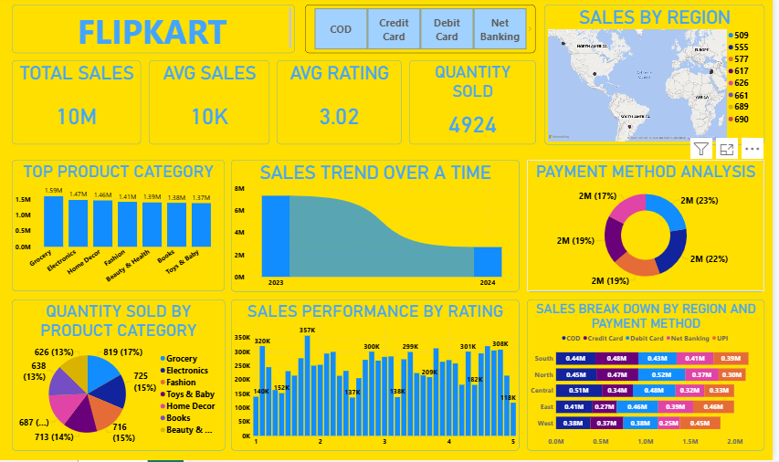

# Flipkart Sales Dashboard using Power BI

📌 Project Overview

This project is an interactive **Flipkart Sales Dashboard** developed using Microsoft Power BI. It provides a consolidated view of sales performance, product categories, regional sales, payment methods, quantities sold, and customer ratings.

The objective of this project is to transform sales data into meaningful visualizations that help users explore business performance and understand sales patterns.

🛠️ Tools & Technologies Used

- Microsoft Power BI
- Power Query
- Power BI Charts and Visualizations
- Interactive Slicers
- Data Analysis and Reporting

📊 Dashboard Components

 1. Sales Summary

The dashboard includes four KPI cards to provide an overview of sales performance:

- **Total Sales** – Displays the total sales amount.
- **Average Sales** – Shows the average sales value.
- **Average Rating** – Displays the average customer rating.
- **Quantity Sold** – Shows the total quantity sold.

 2. Sales by Region

A map visualization displays sales by region, helping users explore the geographical distribution of sales.

 3. Top Product Category

A column chart compares sales across product categories to help identify category-level sales performance.

 4. Sales Trend Over Time

A ribbon chart visualizes sales trends over time, allowing users to explore changes in sales performance across different time periods.

 5. Payment Method Analysis

A donut chart presents the distribution of sales across different payment methods.

 6. Quantity Sold by Product Category

A pie chart compares the quantity sold across product categories to show their contribution to total quantity.

 7. Sales Performance by Rating

A column chart displays sales performance across customer rating values, helping users explore sales patterns associated with ratings.

 8. Sales Breakdown by Region and Payment Method

A bar chart compares regional sales with a breakdown by payment method, bringing together geographical and payment-related insights.

 9. Interactive Payment Method Slicer

The dashboard includes a payment method slicer that allows users to filter the report and explore the available visualizations based on payment method.

🔍 Key Analysis

The dashboard supports the following analyses:

- Overall sales and quantity performance
- Average sales and customer rating
- Regional sales distribution
- Sales comparison across product categories
- Sales trends over time
- Payment method distribution
- Quantity sold by product category
- Sales patterns across customer ratings
- Regional sales comparison by payment method

🎯 Business Applications

This dashboard demonstrates how Power BI can be used to:

- Monitor key sales performance indicators
- Compare sales across product categories
- Explore regional sales patterns
- Understand payment method distribution
- Analyze quantities sold and customer ratings
- Present business information through interactive visualizations
- Support data-informed business discussions

📁 Project Files

```text
Flipkart-Sales-Dashboard/
│
├── FLIPKART DASHBOARD.pbix
└── README.md
```

- **FLIPKART DASHBOARD.pbix** – The Power BI report containing the dashboard and its visualizations.
- **README.md** – Project documentation describing the dashboard, tools, and features.

🚀 How to Run the Project

1. Download or clone this repository.
2. Install Microsoft Power BI Desktop.
3. Download the `FLIPKART DASHBOARD.pbix` file.
4. Open the file in Power BI Desktop.
5. Explore the KPI cards, charts, map, and payment method slicer.

📊 Dashboard Preview



👩‍💻 Author

**Sakshi Sonkusare**

This project was developed as part of my practical learning in **Data Analysis, Business Intelligence, and Power BI Dashboard Development**.
